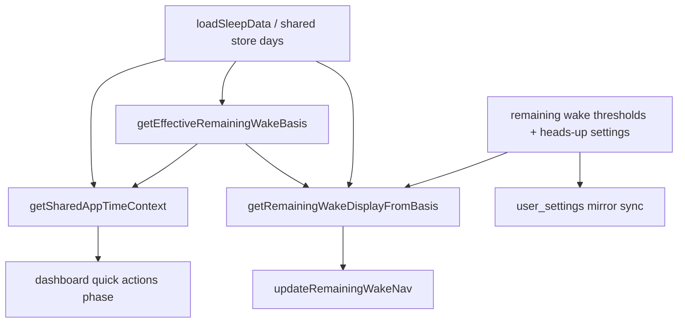

# Remaining wake feature reference

Reference for the remaining-wake implementation (product UI label is often **Remaining time** / legacy **Remaining wake time**) across nav, dashboard behavior, settings/about controls, and cloud sync. This is the master source for current behavior and upcoming work.

Implementation lives mainly in `src/lib/sleep-utils.js`, with route integration in `src/spa-app.js`, `src/routes/dashboard.js`, `src/routes/log.js`, `src/routes/settings.js`, and `src/routes/about.js`.

---

## Scope and terminology

- **Feature name (product):** Remaining time (see backlog item 1 for naming scope).
- **Implementation name:** Remaining wake / remaining-wake (selectors, helpers, storage keys, docs, i18n namespaces).
- **Primary UI surface:** Nav chip in the top header (`#nav-remaining-wake`) showing icon, label, optional heads-up, and progress bar.
- **Secondary surfaces:** Threshold controls in Settings and About pages via `getRemainingWakeThresholdsControlHTML(...)`.

---

## Architecture (data flow)

Core split:

1. **Time basis selection** (`getEffectiveRemainingWakeBasis`).
2. **Display computation** (`getRemainingWakeDisplayFromBasis`).
3. **UI render + classes** (`updateRemainingWakeNav`).
4. **Preferences + sync** (`get/setRemainingWakeThresholds`, `get/setRemainingWakePhaseHeadsUpMinutes`, `syncUserSettingsRowToCloud`).

---

## Basis selection (what clock model remaining wake uses)

Canonical basis comes from `getTonightWakePhaseBasisFromDays(days)`:

1. Recent averages (`computeRecentWakeBasis` → `computeRecentAverages`, the single recent-average helper in `sleep-utils.js`).
2. Optional saved Tonight target window (`getTonightTargetWindow`).
3. Optional session projection adjustment (`getTonightProjectionAdjustment`).

Returned basis:

- `avgSleepStart`
- `avgSleepEnd`
- `totalWakeMins` (duration from average wake to average sleep)

Fallback behavior:

- If the recent-average basis is unavailable (no logged nights), `getFallbackWakeBasis()` is used internally, but the nav shows the 🌱 learning display (`getLearningRemainingWakeDisplay`: *learning your rhythm*, no progress bar) instead of a countdown from default times. While the recent average is learning (fewer than 7 nights), Tonight guidance is held, so a saved target applies directly to the basis.

---

## Display phases

`getRemainingWakeDisplayFromBasis` returns one of these phases. In day order, starting with the morning:

| Phase | Icon | Label | Shown when |
|---|---|---|---|
| `wakingSoon` | 🌅 | *waking soon* | Dynamic Sleep, in the last `WAKING_SOON_NAV_MINS` (60) minutes before the basis wake |
| `open` | ☀️ | countdown | `percentRemaining ≥ openMin` |
| `winding` | 🌇 | countdown | `percentRemaining ≥ windingMin` |
| `presleep` | 🛏️ | countdown, or *get in bed soon* | below `windingMin`; the soft label in overnight limbo with nothing logged |
| `sleepSoon` | 🛏️ | *start sleep soon* | bed logged, fell-asleep not yet |
| `sleep` | 🌙 | *sweet dreams* | Dynamic Sleep, fell-asleep logged |
| `learning` | 🌱 | *learning your rhythm* | no logged nights (`getLearningRemainingWakeDisplay`) |

`open`, `winding` and `presleep` come from the percentage thresholds. The rest come from what you've logged and are not affected by the sliders. Soft labels (`timeLabelSoft: true`) have no countdown: `percentRemaining` is `0` for *get in bed soon* / *start sleep soon* and `null` for the rest.

The display is resolved in this order:

1. **Dynamic Sleep** (below): `wakingSoon`, then `sleepSoon`, then `sleep`.
2. **Overnight limbo** without Dynamic Sleep, wake not logged for the night key: *get in bed soon* (`presleep`), or *start sleep soon* (`sleepSoon`) when bed is logged but fell-asleep isn't.
3. **Countdown**: minutes to the basis sleep time, phase from the thresholds, optional heads-up.

### Percent-threshold phases (`open` / `winding` / `presleep`)

`getRemainingWakePhase(remainingMins, totalWakeMins)`: `percentRemaining ≥ openMin` → `open`, `≥ windingMin` → `winding`, else `presleep`. Formula: [math.md § Remaining-wake phase](math.md).

- Defaults: `openMin = 35`, `windingMin = 15`.
- Stored values are clamped to integer percent, and `openMin > windingMin` is required.

### Dynamic Sleep

`shouldShowDynamicSleepNavPhase(days, basis, now, nightKey)` is true when all of these hold:

- Wake is not logged for the night key (`isNightWakeLogged`).
- Bed or fell-asleep is logged for the night key (`isNightBedOrSleepLogged`: a QA flag, or the loaded row differs from the stub built by `buildStubDayForNightKey`). No wall-clock recency is required, so backfilled rows count.
- The clock is in **overnight limbo** or the **evening sleep window**:
  - **Overnight limbo** (`shouldShowGoToBedSoonWakeNav`): from basis sleep up to, not including, basis wake, measured forward around the clock (`forwardClockMinutes`). Works for schedules on either side of midnight (22:30 → 07:00 and 00:36 → 09:30 alike); empty only when sleep and wake are the same minute.
  - **Evening sleep window** (`inferNavSleepWindowPhase`): `inferSharedSleepContextPhase` returns `sleep`, meaning 120 minutes before through 240 minutes after basis sleep, and not within 105 minutes of basis wake. Constants: [quick-actions.md § Phase and row constants](quick-actions.md#phase-and-row-constants).

Only the night key's row counts. Bed and sleep saves use the same key (`getCurrentNightKey`, natural-wake cutover; see [wake-day-key.md](wake-day-key.md)), so an earlier row still waiting for a wake (a forgotten wake) doesn't count as tonight's bed or sleep. The same holds for `isNightBedLogged` and `isNightSleepOrIntentLoggedNav`.

`isDynamicSleepPhase` in `getSharedAppTimeContext` is this flag. Quick actions use it as their first phase branch; see [quick-actions.md](quick-actions.md).

#### Waking soon (`wakingSoon`)

Inside Dynamic Sleep, when the basis wake is 1–60 minutes away (`forwardClockMinutes(now, basis.avgSleepEnd)`). The basis wake is the recent average, else the Tonight target (guided when guidance is on, as set when off), else the session slider. Takes precedence over `sleepSoon` and `sleep`.

- Header decor: `getDawnDecorHtml()` (rising warm glow, faint horizon line, drifting motes) on a midnight-to-dawn strip (`--nav-phase-tint-dawn`).
- Display only: `isDynamicSleepPhase` stays true, so quick actions keep their sleep-phase set.

#### Start sleep soon (`sleepSoon`)

You're in bed but not asleep yet: bed is logged for the night key (`isNightBedLogged`) and fell-asleep or a sleep intent isn't (`isNightSleepOrIntentLoggedNav`). A sleep intent is the *Sleep in 10 min* quick action.

- Reached two ways: inside Dynamic Sleep (outside the waking-soon hour), and in overnight limbo when Dynamic Sleep is off.
- Label *start sleep soon*, icon 🛏️, `percentRemaining: 0`, no heads-up.
- Unlike bed, the fell-asleep check has a 12-hour wall-clock window (`isWallClockWithinRecentHoursNav`): a fell-asleep time on the row older than 12 hours reads as not logged, so the display stays on *start sleep soon*. A QA sleep flag always counts.
- Header: the *start sleep soon* strip `--nav-phase-tint-sleep-soon` (`.nav-wrapper--phase-sleepSoon`, `.nav-remaining-wake-progress--sleepSoon`), a blend of the theme background and `--color-sleep` ([semantic-keyword-palette.md](semantic-keyword-palette.md)).
- Quick actions treat `sleepSoon` like `presleep`: bedtime actions stay available ([quick-actions.md § Remaining-wake alignment](quick-actions.md#remaining-wake-alignment)).

#### Sweet dreams (`sleep`)

Dynamic Sleep, outside the waking-soon hour, with fell-asleep or a sleep intent logged. Label *sweet dreams*, `percentRemaining: null`. Header decor: twinkling stars (`getNavHeaderTwinkleStarsHtml`) on a midnight strip (`--nav-phase-tint-midnight`).

### Get in bed soon (soft `presleep`)

In overnight limbo when Dynamic Sleep is off (nothing logged for the night key) and wake isn't logged: label *get in bed soon*, phase `getRemainingWakePhase(0, totalWakeMins)` (in practice `presleep`), `percentRemaining: 0`. If bed is logged but fell-asleep isn't, this becomes `sleepSoon` instead.

### Countdown

Otherwise: minutes to the basis sleep time, label `formatDuration(remainingMins)`, `percentRemaining` drives the progress bar, and an optional heads-up comes from `computeRemainingWakePhaseHeadsUp(...)`.

---

## Default Log / quick-add wake-day key

`resolveDefaultQuickAddNightKey(days)` chooses the latest of `sleep_days` / drafts first, otherwise **`getCurrentNightKey(getAppDate(), days)`** — the cutover on the **natural** recent-average wake ([wake-day-key.md](wake-day-key.md)). It does **not** add a calendar day based on nav phase.

---

## Heads-up behavior

Heads-up settings:

- Key: `sleep-app-remaining-wake-phase-heads-up-mins`
- Allowed values: `0, 15, 30, 45, 60`
- Default: `30`

Display behavior:

- Only shown in `open` and `winding` (countdown) phases.
- Shows next phase icon + minutes (for example, "🌇 in 24m").

Wrapper visual blending:

- `updateRemainingWakeNav(...)` toggles `nav-wrapper--rw-heads-up-blend`.
- Uses CSS variable `--nav-header-mid` based on remaining heads-up proportion.

---

## Phase colors (top banner vs wallpaper)

Where the phase tint shows. User setting: Settings → Look and feel → **Phase colors** (**Top banner** / **Wallpaper (full page)**), also in the dev banner's Phase colors dropdown.

- Storage: `user_settings.phase_wallpaper` (`false` = banner, the default) mirrored to localStorage `sleep-app-phase-wallpaper` (`PHASE_WALLPAPER_KEY`, `'1'` = wallpaper). The old dev-only key `sleep-app-dev-phase-wallpaper` is migrated once (`migratePhaseWallpaperLegacyKey`). Column mapping and migration: [user-data-cloud.md](user-data-cloud.md).
- `setPhaseWallpaperEnabled(on)` writes the key, re-applies immediately (no reload), syncs `user_settings`, refreshes the dev panel and the Settings control, and dispatches `phase-wallpaper-changed`.
- `updateRemainingWakeNav()` stores the last display (`lastRemainingWakeNavDisplay`) and calls `applyPhaseWallpaper(display)`. When on, it adds `html.restore-phase-wallpaper` and a fixed `#phase-wallpaper` layer (`z-index: -1`, prepended to `body`) with `phase-wallpaper--phase-<phase>` for every display phase above. During a heads-up it also gets `phase-wallpaper--rw-heads-up-blend` and the `--nav-header-mid` value copied from `.nav-wrapper`, so it uses the same tint variables as the header, stretched over the viewport.
- Decor: in `sleep` (*sweet dreams*) the layer fills with a 42-star field (`getPhaseWallpaperStarsHtml()`, R2-sequence positions, reusing the `.nav-header-twinkle-star` animation). In `wakingSoon` it shows the dawn decor (`getDawnDecorHtml(16)`). The header's own decor layer is hidden, and the header background and outline go transparent.
- Wallpaper tints are stronger than the header strip (`--nav-phase-tint-*` redeclared on `.phase-wallpaper`), and `.container` panels become ~82% opaque so the wallpaper shows through slightly.
- Settings preview (`getPhaseWallpaperPreviewHtml`): five static tiles in day order, **Waking soon → Active → Winding → Pre-sleep → Asleep**. The fill covers a top strip (banner) or the whole tile (wallpaper).

---

## UI integration by route

`src/spa-app.js` route config includes `remainingWake` control:

- Dashboard + Log call `initRemainingWakeNav({ interval: false })` because those pages refresh nav with their own page data/timers.
- Other routes call `initRemainingWakeNav()` with built-in 60s refresh interval.

Route specifics:

- **Dashboard:** updates nav after dashboard render and after Tonight adjuster changes.
- **Log:** updates nav from page data and runs its own 60s interval.
- **Settings/About:** mount threshold controls and initialize threshold config wiring.

---

## Persistence and cloud sync

Local storage:

- Thresholds: `sleep-app-remaining-wake-thresholds` JSON `{ openMin, windingMin }`
- Heads-up: `sleep-app-remaining-wake-phase-heads-up-mins`

Cloud mirror columns (`user_settings`):

- `remaining_wake_open_min`
- `remaining_wake_winding_min`
- `remaining_wake_phase_heads_up_mins`

Write path:

- Setters write local first, then call `syncUserSettingsRowToCloud()` (when cloud gate is on).

Read/hydrate path:

- `ensureUserSettingsFromCloud` maps DB row back to local storage via `userSettingsRowToLocalStorage`.

---

## Accessibility and links

- Nav chip is rendered as a link to Settings Remaining wake time (`settings.remainingWake` route key); About `#remaining-wake-time` stays the narrative deep link from Settings.
- ARIA label changes by state (remaining time, sleep, get-in-bed-soon / start-sleep-soon, heads-up announcement).
- Settings controls provide ARIA labels on sliders and heads-up selectors.

---

## Styling notes

- Remaining wake nav and controls are styled in `src/styles/styles.css` (`.nav-remaining-wake-*`, `.config-remaining-wake-*`).
- Sleep-domain colors should follow SKP tokens from `docs/semantic-keyword-palette.md` (`--color-sleep`, `--color-bed`, `--color-up`, etc.) for any future phase visuals.

---

## Source map (quick index)

| Concept | Primary symbols |
|--------|------------------|
| Threshold storage + defaults | `REMAINING_WAKE_THRESHOLDS_KEY`, `DEFAULT_REMAINING_WAKE_OPEN_MIN`, `DEFAULT_REMAINING_WAKE_WINDING_MIN`, `getRemainingWakeThresholds`, `setRemainingWakeThresholds` |
| Heads-up storage + conversion | `REMAINING_WAKE_PHASE_HEADS_UP_KEY`, `REMAINING_WAKE_PHASE_HEADS_UP_ALLOWED`, `getRemainingWakePhaseHeadsUpMinutes`, `setRemainingWakePhaseHeadsUpMinutes`, slider conversion helpers |
| Basis selection | `computeRecentWakeBasis`, `getTonightWakePhaseBasisFromDays`, `getEffectiveRemainingWakeBasis`, `getFallbackWakeBasis` |
| Phase/time inference | `getRemainingWakePhase`, `getRemainingWakeIcon`, `computeRemainingWakePhaseHeadsUp`, `shouldShowGoToBedSoonWakeNav`, `WAKING_SOON_NAV_MINS` |
| Dynamic sleep logic | `shouldShowDynamicSleepNavPhase`, `isNightBedOrSleepLogged`, `isNightBedLogged`, `isNightSleepOrIntentLoggedNav`, `isNightWakeLogged`, `inferNavSleepWindowPhase` |
| Display object | `getRemainingWakeDisplayFromBasis`, `getRemainingWakeDisplayFromDays`, `getLearningRemainingWakeDisplay` |
| Nav render | `updateRemainingWakeNav`, wrapper phase classes, heads-up blend class |
| Lifecycle/init | `initRemainingWakeNav`, route config `remainingWake` in `src/spa-app.js` |
| Default log date | `resolveDefaultQuickAddNightKey`, `nightKeyForSleepPeriod` |
| Phase colors (wallpaper) | `getPhaseWallpaperEnabled`, `setPhaseWallpaperEnabled`, `applyPhaseWallpaper`, `getPhaseWallpaperStarsHtml`, `getDawnDecorHtml`, `getPhaseWallpaperPreviewHtml`, `initPhaseWallpaperConfigControls` — `src/lib/sleep-utils.js`; `.phase-wallpaper*`, `html.restore-phase-wallpaper` — `src/styles/styles.css` |

---

## Work remaining (backlog for next implementation passes)

### 1) Naming and product-language alignment

Current code/docs mostly say "Remaining wake time" while product direction is "Remaining time".

- Decide canonical naming scope (UI-only rename vs helper/storage/doc rename too).
- If renaming keys/symbols, define compatibility strategy for localStorage and cloud column names.
- Update route hashes/anchors only if backwards links are preserved.
- Settings (`config.remainingWake.intro`, `config.remainingWake.phase.sleepHint`) and About (`#remaining-wake-time`) still describe a single "fourth phase (moon)". The nav now also has *waking soon*, *start sleep soon* and *learning your rhythm*.

### 2) i18n completion for nav runtime strings

Some nav labels are still hard-coded English in display/render paths (for example `sweet dreams`, `waking soon`, `get in bed soon`, `start sleep soon`, and heads-up text formatting).

- Move remaining hard-coded nav strings to translation keys.
- Confirm ARIA text and visible text both localize correctly.

### 3) Single-source refresh model

Remaining wake updates currently come from mixed paths (global init interval + page-level updates/timers).

- Decide one canonical refresh ownership model (shared store subscription vs per-route timers).
- Remove duplicate timing logic once ownership is consolidated.

### 4) Live basis freshness guarantees

`initRemainingWakeNav` computes `basis`/`days` once, then interval refresh uses those captured values.

- Confirm expected behavior when data/settings change without remount.
- If stale behavior is undesired, recalc basis from fresh store snapshot each tick (or subscribe to store changes).

### 5) Test coverage around phase boundaries

Behavior depends on minute/percent thresholds and dynamic sleep overrides.

- Add deterministic tests around 35/15 defaults, custom thresholds, and 0/15/30/45/60 heads-up settings.
- Add boundary tests around wake proximity and sleep-window transitions via shared context helpers.

### 6) Documentation ownership

This doc owns the nav display: phases, Dynamic Sleep, soft labels, phase colors. [quick-actions.md](quick-actions.md) owns quick-action phase, button eligibility and save rows, and links here for Dynamic Sleep. [user-data-cloud.md](user-data-cloud.md) owns storage and sync.

- When phase constants or thresholds change, update this doc in the same PR.

---

## Change checklist (for future PRs touching this feature)

- Update `docs/remaining-wake.md` with behavior changes.
- Verify Settings and About threshold controls stay in sync.
- Verify nav ARIA + visible labels in both themes.
- Verify cloud/local persistence paths for thresholds and heads-up.
- Verify quick-actions alignment when phase logic changes.
